

<picture><source media="(prefers-color-scheme: dark)" srcset="assets/hero-dark.svg"></picture>

<picture><source media="(prefers-color-scheme: dark)" srcset="assets/social-l-dark.svg"></picture><a href="https://t.me/celinejvm"><picture><source media="(prefers-color-scheme: dark)" srcset="assets/social-1-dark.svg"></picture></a><a href="https://discord.com/3ty0"><picture><source media="(prefers-color-scheme: dark)" srcset="assets/social-2-dark.svg"></picture></a><a href="https://soundcloud.com/itzceline1337"><picture><source media="(prefers-color-scheme: dark)" srcset="assets/social-3-dark.svg"></picture></a><a href="https://github.com/Celine1337"><picture><source media="(prefers-color-scheme: dark)" srcset="assets/social-4-dark.svg"></picture></a><picture><source media="(prefers-color-scheme: dark)" srcset="assets/social-r-dark.svg"></picture>

<picture><source media="(prefers-color-scheme: dark)" srcset="assets/stack-dark.svg"></picture>

<a href="https://github.com/Celine1337/wkill"><picture><source media="(prefers-color-scheme: dark)" srcset="assets/project-wkill-dark.svg"></picture></a>&nbsp;<a href="https://github.com/Celine1337/module-audit"><picture><source media="(prefers-color-scheme: dark)" srcset="assets/project-module-audit-dark.svg"></picture></a>

<a href="https://github.com/Celine1337/spi-wire"><picture><source media="(prefers-color-scheme: dark)" srcset="assets/project-spi-wire-dark.svg"></picture></a>&nbsp;<a href="https://github.com/Celine1337/iptables-save"><picture><source media="(prefers-color-scheme: dark)" srcset="assets/project-iptables-save-dark.svg"></picture></a>

<picture><source media="(prefers-color-scheme: dark)" srcset="assets/stats-dark.svg"></picture>

<picture><source media="(prefers-color-scheme: dark)" srcset="assets/streak-dark.svg"></picture>

<picture><source media="(prefers-color-scheme: dark)" srcset="assets/wave-dark.svg"></picture>

<a href="https://metawka.github.io/expressive-profile/?from=Celine1337"><picture><source media="(prefers-color-scheme: dark)" srcset="assets/credit-dark.svg"></picture></a>

